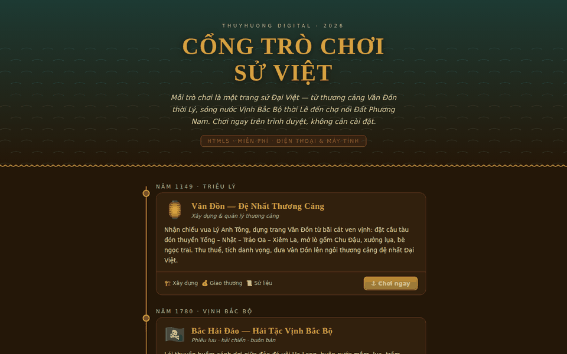
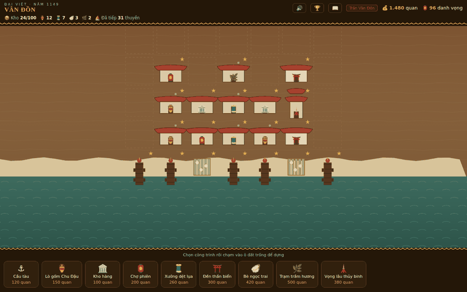
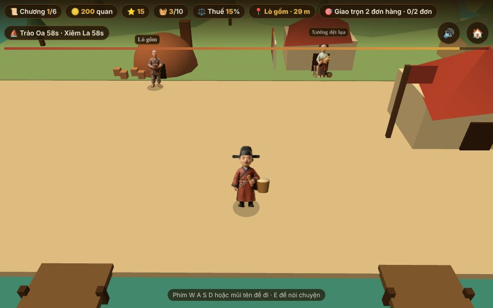
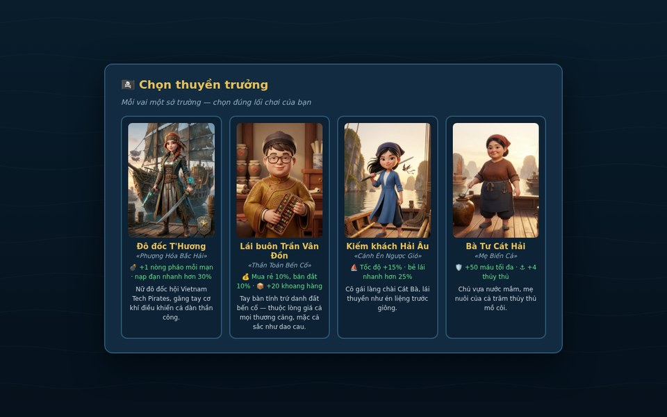
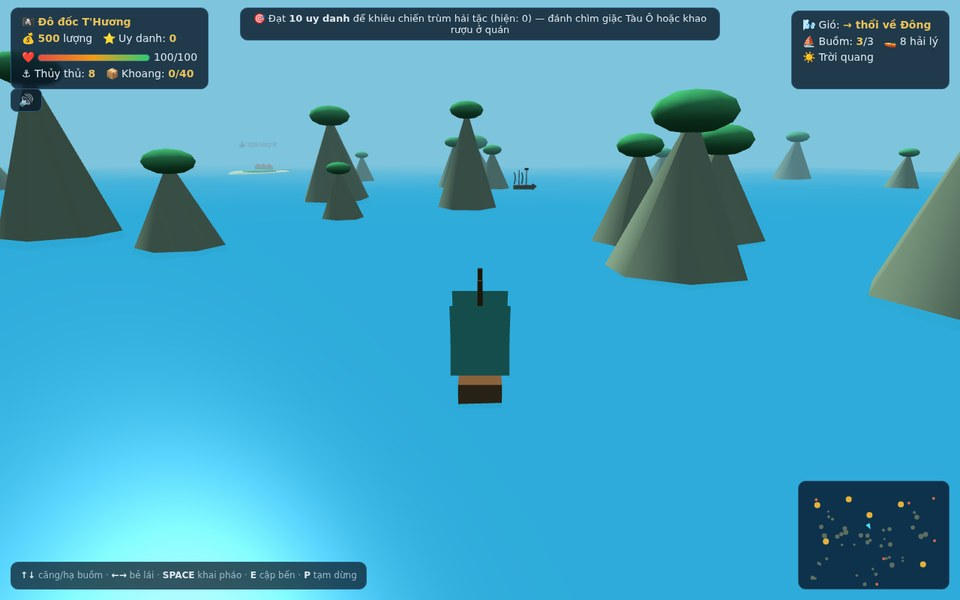
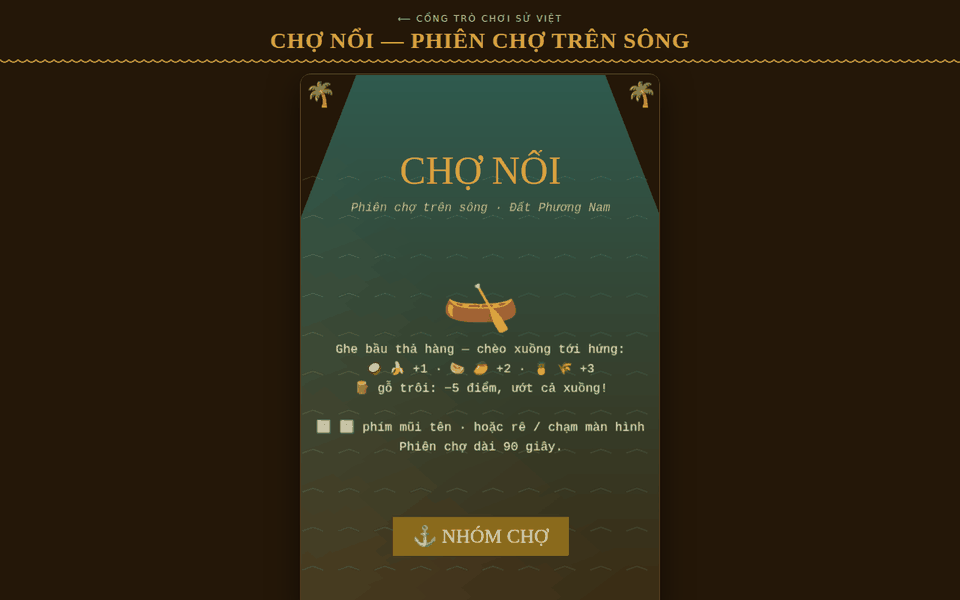

<div align="center">

# Vietnamese History Games

### Cổng Trò Chơi Sử Việt · *ThuyHuong Digital 2026*

Five browser-based educational games set in Vietnamese history, published as an
installable, offline-capable web application.

[](https://github.com/thuyhuongctu/Vietnamese-History-Games/releases)
[](https://doi.org/10.5281/zenodo.21850564)
[](https://thuyhuongctu.github.io/Vietnamese-History-Games/)
[](LICENSE)
[](van-don-3d/)
[](cho-noi/)

**[▶ Play now: thuyhuongctu.github.io/Vietnamese-History-Games](https://thuyhuongctu.github.io/Vietnamese-History-Games/)**

*No installation, no account, no advertising, no data collection.*

</div>

> **The repository was renamed on 13 November 2026** from `ThuyHuong_Digital-2026-Games`
> to `Vietnamese-History-Games`. Git operations on the old name are redirected by GitHub,
> but the old GitHub Pages address (`thuyhuongctu.github.io/ThuyHuong_Digital-2026-Games/`)
> no longer serves the site. Please update bookmarks and links. Steps for the Google Play
> build are in [`HUONG-DAN-PHAT-HANH.md`](HUONG-DAN-PHAT-HANH.md#doi-ten-kho).

---

## Contents

- [Overview](#overview)
- [Screenshots](#screenshots)
- [The games](#the-games)
- [History and fiction](#history-and-fiction)
- [Educational use](#educational-use)
- [Features](#features)
- [Getting started](#getting-started)
- [Repository structure](#repository-structure)
- [Implementation notes](#implementation-notes)
- [Privacy](#privacy)
- [Releases and archiving](#releases-and-archiving)
- [How to cite](#how-to-cite)
- [License and third-party components](#license-and-third-party-components)
- [Author and contact](#author-and-contact)

## Overview

**Vietnamese History Games** (*Cổng Trò Chơi Sử Việt*) is a portal of five HTML5
games covering three settings: the maritime trading port of Vân Đồn from its
founding under the Lý dynasty in 1149, piracy and coastal trade in the Gulf of
Tonkin in 1780, and the floating markets of the Mekong Delta during the
nineteenth-century settlement of the southern provinces.

The portal homepage presents the games as a chronological timeline, labels the
Vân Đồn and Bắc Hải Đảo settings as **based on historical records** or **fiction**, and applies a
single visual identity derived from Lý–Trần dynasty ceramic colours. Each game is a
self-contained `index.html` that needs no build step, no server-side component and
no account. The portal is a Progressive Web App: once loaded it can be installed to
a device home screen, runs full screen, and remains playable without a network
connection.

The project is developed and maintained by a single author as a free,
non-commercial contribution to Vietnamese-language educational resources on the
web. It is free to play and to teach with, but it is not open-source software: see
[License](#license-and-third-party-components).

## Screenshots

<table>
<tr>
<td width="50%"></td>
<td width="50%"></td>
</tr>
<tr>
<td><b>Portal</b> — the games on a chronological timeline, labelled by historical basis.</td>
<td><b>Vân Đồn (1149)</b> — the port after several rounds of construction: piers, pottery kilns, silk workshops, shrines and a naval watchtower.</td>
</tr>
<tr>
<td></td>
<td></td>
</tr>
<tr>
<td><b>Vân Đồn 3D (1149–1348)</b> — walking the quay as a clay figure; ships wait at the piers with orders against the clock.</td>
<td><b>Bắc Hải Đảo (1780)</b> — four playable captains, each with distinct starting conditions and abilities.</td>
</tr>
<tr>
<td></td>
<td></td>
</tr>
<tr>
<td><b>Bắc Hải Đảo 3D (1780)</b> — the same world under a chase camera, with limestone karsts, sea surface and weather in three dimensions.</td>
<td><b>Chợ Nổi (19th century)</b> — a ninety-second market session on the canals of the Mekong Delta.</td>
</tr>
</table>

## The games

| | Game | Setting | Basis | Genre | Play |
|---|---|---|---|---|---|
| 🏮 | **Vân Đồn** — The First Trading Port | 1149 | Historical records | City building, port management | [Play](https://thuyhuongctu.github.io/Vietnamese-History-Games/van-don/) · [About](https://thuyhuongctu.github.io/Vietnamese-History-Games/van-don/gioi-thieu.html) · [Guide](van-don/README.md) |
| 🚶 | **Vân Đồn 3D** — Walking the Quay | 1149–1348 | Historical records | 3D trading, time pressure, building | [Play](https://thuyhuongctu.github.io/Vietnamese-History-Games/van-don-3d/) · [About](https://thuyhuongctu.github.io/Vietnamese-History-Games/van-don/gioi-thieu.html) · [Guide](van-don-3d/README.md) |
| 🏴‍☠️ | **Bắc Hải Đảo** — Pirates of the Gulf of Tonkin | 1780 | Fiction | Adventure, trading, naval combat | [Play](https://thuyhuongctu.github.io/Vietnamese-History-Games/bac-hai-dao/) · [About](https://thuyhuongctu.github.io/Vietnamese-History-Games/bac-hai-dao/gioi-thieu.html) · [Guide](bac-hai-dao/README.md) |
| 🌊 | **Bắc Hải Đảo 3D** | 1780 | Fiction | The same world rendered in 3D | [Play](https://thuyhuongctu.github.io/Vietnamese-History-Games/bac-hai-dao-3d/) · [Guide](bac-hai-dao-3d/README.md) |
| 🛶 | **Chợ Nổi** — Floating Market | 19th century | Historical setting | Arcade, reaction and timing | [Play](https://thuyhuongctu.github.io/Vietnamese-History-Games/cho-noi/) · [About](https://thuyhuongctu.github.io/Vietnamese-History-Games/cho-noi/gioi-thieu.html) · [Guide](cho-noi/README.md) |

### Vân Đồn — The First Trading Port (1149)

In 1149, in the reign of King Lý Anh Tông, the court established Vân Đồn, commonly
regarded as the first international trading port of Đại Việt. The player develops
the port from a fishing hamlet: building piers for merchant ships from Song China,
Srivijaya, Java and Siam; opening pottery kilns, silk workshops and pearl-diving
stations; collecting tax revenue; weathering storms; and repelling raids. The game
includes tiered building upgrades, royal tribute quests, an in-game history codex,
an achievements board, and a challenge mode recreating the Battle of Vân Đồn (1288),
in which Trần Khánh Dư intercepted the Yuan supply fleet.

### Vân Đồn 3D — Walking the Quay (1149–1348)

The player walks the quay in three dimensions as a court official or a woman
merchant, across six chapters. Three chapters follow entries in the *Đại Việt sử ký
toàn thư* (the founding in 1149, the arrival of Siamese and Srivijayan merchants in
1184, and the Đồ Bồ ship secretly buying pearls in 1348); the other three are
constructed by the game. Ships arrive one by one, each placing an order and waiting
only a short time; prices change from chapter to chapter; the court sets one task
per chapter; and the player can build carts, a larger kiln, a naval watchtower and a
sea shrine. A player whose reputation falls below zero is dismissed. Every character
is a photographed clay figure, cut out and placed in the scene; the player's figure
walks on separate feet. The game has its own theme song, *Vân Đồn – Tiếng vọng non sông*.

### Bắc Hải Đảo — Pirates of the Gulf of Tonkin (1780)

A maritime adventure among the limestone karsts of Hạ Long Bay. The player sails a
bat-wing junk between six ports, trades fish sauce, silk, agarwood and pearls,
engages Tàu Ô pirate vessels, survives storms, and finally confronts the pirate lord
Hắc Giao to become King of the Northern Sea. Four playable captains provide distinct
starting conditions and abilities. The characters and story are fiction; the theme
song is *Bắc Hải Đảo – Theo cánh buồm quê hương*.

### Bắc Hải Đảo 3D (1780)

The same world rebuilt in three dimensions with three.js: a chase camera behind the
junk, animated sea surface, limestone islands, three-dimensional ports and enemy
vessels, storm weather, and the Dragon of Hạ Long. All gameplay systems of the 2D
version are retained, and both versions remain available so that the portal still
works on low-powered devices.

### Chợ Nổi — Floating Market (19th century)

An arcade game set in the floating markets that formed along the canals of the
Mekong Delta as settlers opened up the southern provinces. A merchant barge crosses
the river releasing produce; the player steers a sampan (*xuồng ba lá*) to catch
coconuts, bananas, watermelons, mangoes, pineapples and rice (one to three points
each) while avoiding driftwood (minus five points). A session lasts ninety seconds
and the drop rate increases progressively. Built on the Phaser 3 engine.

## History and fiction

The portal labels the Vân Đồn and Bắc Hải Đảo settings so that players and teachers
can tell record from invention:

- **📜 Based on historical records** — the Vân Đồn games. Dates, nations and events
  cited in the games come from the *Đại Việt sử ký toàn thư*; each game has a
  history codex or stele that lists what is recorded and, separately, what the game
  simplifies or invents (tax rates, prices, the title «quan trấn thủ» in 1149,
  constructed chapters). Characters are photographed clay figures checked against
  the period: no blue-and-white porcelain, no dragon embroidery for officials, no
  Quốc ngữ signs. The prompts and checklist used for the figures are kept in
  [`van-don-3d/PROMPT-NHAN-VAT.md`](van-don-3d/PROMPT-NHAN-VAT.md).
- **🎭 Fiction** — the Bắc Hải Đảo games. The year, the bay and the Tàu Ô pirates
  give the setting; captains, villains, the dragon and the kingship are invented.
  Fictional characters do not appear in the history-based games.

All five games are still works of interactive fiction: mechanics, difficulty and
narrative details are designed for playability and should not be cited as a
scholarly source.

## Educational use

The games are intended for secondary and undergraduate teaching, for self-directed
learning, and for general audiences interested in Vietnamese history. They run on
shared or low-specification school computers and on mobile phones, and continue to
work offline after the first load, which makes them usable in classrooms without
reliable internet access. The end screen of Vân Đồn 3D closes with reflection
questions on trade-offs (which ship to serve first with limited cargo, when to
invest in buildings, how tax rates affect demand) that can open a class discussion.

## Features

- **Five games** sharing one visual identity and historical frame
- **Installable Progressive Web App**: home-screen installation, full-screen
  presentation, and complete offline operation through a service worker, web
  manifest and icon set
- **Generated music**: in-game background music synthesised in real time with the
  Web Audio API on the Vietnamese pentatonic scale, emulating *đàn tranh* plucked
  strings and *đàn bầu* pitch bends
- **Theme songs**: two sung theme songs in Vietnamese (Vân Đồn and Bắc Hải Đảo),
  played from the title screen and the victory screen, with lyrics; each song is
  downloaded only when the player first listens, then cached for offline use. A
  third song shared by both games, *Người trao ta chân trời*, plays from the
  portal homepage, with its lyrics
- **Desktop and mobile input**: keyboard on desktop, touch joystick and buttons on
  phones and tablets
- **Local progress storage**: saved games and high scores stay in browser storage on
  the device
- **Bilingual material**: game text in Vietnamese; documentation and store listings
  in Vietnamese and English

## Getting started

### Play online

Open the [portal](https://thuyhuongctu.github.io/Vietnamese-History-Games/) in any
modern browser. On Android, choose **Install** (or **Add to Home Screen**) to get
the full-screen offline application. On iOS, use Safari and choose
**Share → Add to Home Screen**. A Google Play build (a Trusted Web Activity wrapping
the same site) is in closed testing.

### Requirements

A current version of Chrome, Edge, Firefox or Safari with JavaScript enabled. No
installation, account, plug-in or build toolchain is required. The 3D editions
benefit from WebGL hardware acceleration; the 2D editions do not need it.

### Run locally

```bash
git clone https://github.com/thuyhuongctu/Vietnamese-History-Games.git
cd Vietnamese-History-Games
python3 -m http.server 8000     # then open http://localhost:8000
```

The 2D games also run when `index.html` is opened directly from the file system.
Serving the directory over HTTP is needed for the 3D games' textures, the theme
songs, the service worker and the installation prompt.

### Deployment

The repository is the deployable site. Any static host will serve it; the published
instance is on GitHub Pages, and each push to `main` is deployed automatically.
Guidance on the Google Play build (Bubblewrap / Trusted Web Activity) and store
listings is in [`HUONG-DAN-PHAT-HANH.md`](HUONG-DAN-PHAT-HANH.md) (in Vietnamese).

## Repository structure

```
.
├── index.html               Portal homepage (chronological timeline)
├── van-don/                 Vân Đồn: port building, 2D canvas (1149); gioi-thieu.html About page
├── van-don-3d/              Vân Đồn 3D: walking the quay, three.js (1149–1348)
│   ├── assets/              Clay-figure cut-outs, portraits, scene photos, theme song
│   └── PROMPT-NHAN-VAT.md   Image prompts and period checklist for the figures
├── bac-hai-dao/             Bắc Hải Đảo: pirate adventure, 2D canvas (1780); gioi-thieu.html About page
│   ├── assets/              Captain artwork and theme song
│   └── PROMPT-VUA.md        Image prompts for the victory («King») artwork
├── bac-hai-dao-3d/          Bắc Hải Đảo 3D: three.js edition
├── cho-noi/                 Chợ Nổi: floating market, Phaser 3 (19th century); gioi-thieu.html About page
├── lib/three.min.js         Vendored three.js r147
├── assets/vendor/           Vendored Phaser 3.90.0 and its licence
├── assets/nhac/             Người trao ta chân trời, the song shared by both games
├── assets/portal/           Portal thumbnails and the shared CSS of the About pages
├── icons/                   Application icon set (192, 512, maskable)
├── docs/                    Screenshots and the Zenodo description
├── store-assets/            Store listings, data-safety answers, promotional graphics
├── manifest.webmanifest     Web application manifest with per-game shortcuts
├── sw.js                    Service worker (cache-first; bump VERSION on each release)
├── privacy.html             Privacy policy, Vietnamese and English
├── HUONG-DAN-PHAT-HANH.md   Release and store-submission guide (Vietnamese)
├── CITATION.cff             Citation metadata for GitHub and Zenodo
└── .zenodo.json             Archival metadata Zenodo reads on each release
```

## Implementation notes

| Layer | Implementation |
|---|---|
| 2D games (Vân Đồn, Bắc Hải Đảo) | HTML5 canvas and vanilla JavaScript, one self-contained file per game |
| 3D games (Vân Đồn 3D, Bắc Hải Đảo 3D) | [three.js](https://threejs.org/) r147, vendored locally |
| Characters in Vân Đồn 3D | Photographed clay figures, background removed, shown as camera-facing cut-outs (WebP with alpha); the player figure is split into body and two feet for walking |
| 2D game engine (Chợ Nổi) | [Phaser 3](https://phaser.io/) v3.90.0, vendored locally |
| Audio | Web Audio API for generated music and sound effects; three MP3 songs fetched on demand |
| Application platform | Progressive Web App: manifest, service worker, shortcuts |
| Persistence | Browser `localStorage`, device-local only |
| Distribution | GitHub Pages; Trusted Web Activity build for Google Play; home-screen installation on iOS |
| Archiving | Each release is deposited in [Zenodo](https://doi.org/10.5281/zenodo.21850564) with a DOI |

The project uses no build tooling and no content delivery networks. The two external
libraries are vendored so that the application works fully offline and each archived
release is complete and independently executable. The service worker pre-caches the
pages, libraries and images at installation; the songs (about 4–6 MB each) are
left out of the pre-cache and cached on first play, to keep the first installation
light.

**Engine selection.** Phaser 3 was adopted for new 2D work after evaluating a range of
open-source game engines. It is a single-file, MIT-licensed JavaScript library that
runs from a static host without a build step and is actively maintained.
Editor-centred engines (Godot, Cocos, GDevelop) were not adopted because they require
an export pipeline; engines targeting the Java, C# or C++ toolchains (libGDX,
MonoGame, jMonkeyEngine, Torque3D, Spring, gameplay3d, OpenRTS) are not deployable as
a static website; Babylon.js was not adopted because the portal already vendors
three.js; and several browser engines considered (Starling, Turbulenz, Crafty,
whs.js, Superpowers, Atomic) are no longer maintained.

## Privacy

The application collects no personal data. It has no analytics, no advertising, no
third-party requests at runtime, and no server-side component. Saved games, high
scores and the sound on/off choice are written to browser storage on the user's own
device and can be removed by clearing site data. The full policy is in
[`privacy.html`](privacy.html).

## Releases and archiving

Releases are tagged in GitHub and deposited automatically in Zenodo, where each
release receives its own version DOI in addition to the concept DOI that represents
the project as a whole. The archived record is the citable version of record.
Releases published before the rename keep the old repository address in their
archived metadata.

## How to cite

[](https://doi.org/10.5281/zenodo.21850564)

The author of record is **Do Thuy Huong** (Đỗ Thùy Hương). Citation metadata is kept
in [`CITATION.cff`](CITATION.cff), from which GitHub's **Cite this repository**
control exports APA and BibTeX, and in [`.zenodo.json`](.zenodo.json), which Zenodo
reads when it archives each release.

> Do, T. H. (2026). *ThuyHuong Digital 2026 — Games: Cổng Trò Chơi Sử Việt
> (Vietnamese History Game Portal)* [Computer software]. Zenodo.
> https://doi.org/10.5281/zenodo.21850564

```bibtex
@software{do_thuyhuong_digital_games_2026,
  author    = {Do, Thuy Huong},
  title     = {{ThuyHuong Digital 2026 --- Games: Cổng Trò Chơi Sử Việt
               (Vietnamese History Game Portal)}},
  year      = {2026},
  publisher = {Zenodo},
  doi       = {10.5281/zenodo.21850564},
  url       = {https://doi.org/10.5281/zenodo.21850564}
}
```

The DOI above is the **concept DOI**: it represents all versions and always resolves
to the most recent release. Individual releases carry their own DOIs:

| Version | DOI |
|---|---|
| 1.2 (latest) | [10.5281/zenodo.21899097](https://doi.org/10.5281/zenodo.21899097) |
| 1.1 | [10.5281/zenodo.21898774](https://doi.org/10.5281/zenodo.21898774) |
| 1.0 | [10.5281/zenodo.21850565](https://doi.org/10.5281/zenodo.21850565) |

## License and third-party components

**© 2026 Do Thuy Huong (Đỗ Thùy Hương). All rights reserved.** See
[`LICENSE`](LICENSE) for the full bilingual terms.

The games are published to be played, taught with and cited, not to be reused as
source material. Playing the games at the official address, non-commercial classroom
use by teachers and institutions, reading the source for personal learning, academic
citation with attribution and the DOI, and screenshots or review videos with credit
are all permitted without prior permission. Redistribution, re-deployment,
modification, derivative works, extraction of artwork or music, publication to
application stores, fee-charging use, and use as training data for commercial AI
systems require the author's prior written permission.

Licensing enquiries: [thuyhuongctu@gmail.com](mailto:thuyhuongctu@gmail.com)

Vendored third-party libraries are excluded from the reservation above and keep their own licences:

| Component | Version | Licence |
|---|---|---|
| [Phaser](https://phaser.io/) | 3.90.0 | MIT ([`assets/vendor/PHASER-LICENSE.md`](assets/vendor/PHASER-LICENSE.md)) |
| [three.js](https://threejs.org/) | r147 | MIT |

## Author and contact

**Do Thuy Huong** (Đỗ Thùy Hương), ThuyHuong Digital.

Correspondence: [thuyhuongctu@gmail.com](mailto:thuyhuongctu@gmail.com)

Issues and suggestions are welcome through the repository
[issue tracker](https://github.com/thuyhuongctu/Vietnamese-History-Games/issues).

Related project by the same author: [BizOn](https://bizonland.com/), a set of simulation
games for learning international business. BizOn lists *Vân Đồn* among its extended games,
and the portal footer, the Vân Đồn introduction page and the Vân Đồn achievements panel link
back to it. BizOn is a separate site with its own privacy policy.

---

<div align="center">

© 2026 Do Thuy Huong (ThuyHuong Digital). Further games are planned.

</div>
